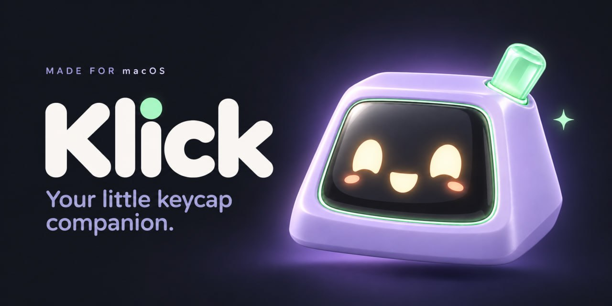

# Klick

Keyboard sounds for macOS, with a companion called **Kiki** — a little keycap who
presses along with you.

A native macOS app: **7 MB**, and **~2–4 ms** from key to ear.



## Download

Grab the DMG for your Mac from [Releases](https://github.com/Surenkh/klick-desktop/releases/latest):

| Mac | File |
| --- | --- |
| Apple silicon (M1–M6) | `Klick-0.5.0-arm64.dmg` |
| Intel | `Klick-0.5.0-x64.dmg` |

Open the DMG, drag **Klick** to Applications, then launch it. macOS will refuse an
unsigned app once: **System Settings → Privacy & Security → Open Anyway**. Klick then
asks for **Input Monitoring** — one switch, and it can never see what you type or
block a keystroke.

## What it does

- A real keyboard sound under every key, in every app, from **five packs**
  (laptop, hard, fast, soft, and *studio* — synthesised from an acoustic profile of
  real keyboards).
- **Kiki** floats above your windows, bounces on every key, can be dragged
  anywhere, and slaps back (+10 XP) when you click him.
- **XP, levels and hats** — every key earns XP, Kiki levels up, and six hats unlock
  along the way. The Today tab shows a live progress bar and your wardrobe.
- **Three volume channels** — key taps, celebrations, and agent cues each have their
  own slider.
- **Agent cues** for Claude Code (Cursor and Codex are on the roadmap): a soft chime
  when a task finishes, a sharper one when it fails, two rising notes when it needs
  you.
- Menu bar control: sounds on/off, volume, pack, Kiki, launch at login.

## Permissions, honestly

Only **Input Monitoring**. Klick uses a listen-only `CGEventTap`, so the OS forbids
it from modifying, blocking or delaying a keystroke. No Accessibility, no Screen
Recording, no microphone, no network, no account, no telemetry.

## Why it is small and fast

| Metric | Klick 0.5.0 (native) |
| --- | --- |
| App size | **7 MB** |
| DMG | **7 MB** |
| Key-to-ear latency | **~2–4 ms** |
| Runtime | AppKit + CoreAudio |

A key press goes straight from the system key tap into a lock-free buffer that the
audio engine drains, with a 64-frame hardware buffer. Nothing in the middle can
delay it. Details in [ARCHITECTURE.md](ARCHITECTURE.md).

## Build from source

Requires Xcode Command Line Tools (clang), macOS 14+.

```sh
sh scripts/test-native.sh      # 48 checks: keymap, packs, mixer, cues, stats
sh scripts/build-native.sh     # build + sign for this Mac
sh scripts/build-native.sh --install   # build, install to /Applications, launch
sh scripts/package-native.sh   # both DMGs into dist/
```

There is no `npm install` — the app has no runtime dependencies.

## Project layout

```
native/app/     Objective-C shell, CoreAudio engine, CGEventTap capture, bridge
src/renderer/   settings.html + buddy.html (the same UI, now inside WKWebView)
assets/         sound packs, Kiki art, cues, icons
tests/          native smoke tests
scripts/        build, package, test, asset tooling
docs/           release notes and screenshots
```

## Docs

- [ARCHITECTURE.md](ARCHITECTURE.md) — the critical path, device handling, permissions
- [DOCS.md](DOCS.md) — features and internals
- [CHANGELOG.md](CHANGELOG.md) — version history
- [INSTALL.md](INSTALL.md) — install and troubleshooting
- [CREDITS.md](CREDITS.md) — asset provenance

## Licence

Code: **MIT** — see [LICENSE](LICENSE).

Kiki's artwork is © Suren Khachatryan (all rights reserved) and the sound packs carry
the Mixkit Free License; neither may be redistributed as standalone assets. Details in
[ASSET-LICENSES.md](ASSET-LICENSES.md).
